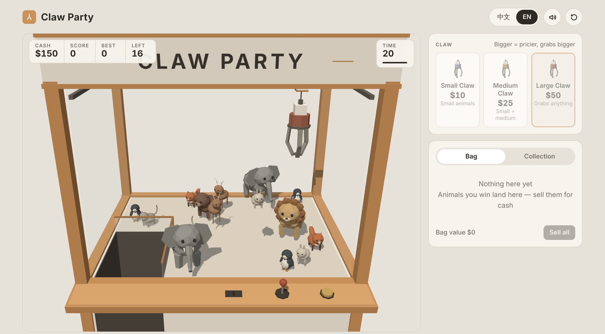

# Claw Party

A low-poly 3D claw machine game that runs in the browser.

**Play:** https://chesteroooo.github.io/claw-party/

[](https://chesteroooo.github.io/claw-party/)

## Controls

| Input | Action |
|---|---|
| `W` `A` `S` `D` / arrow keys | Move claw |
| `Space` | Insert coin / drop |
| `1` `2` `3` | Select claw size |
| Drag / scroll | Orbit / zoom camera |
| Double-click | Reset camera |

Touch controls are available on mobile.

## Gameplay

- You start with $200. Each play costs $10 / $25 / $50 depending on claw size, and larger claws can grab larger animals.
- Each round has a 20-second timer.
- You can sell prizes for cash. The game ends when you have no cash and nothing left to sell.
- Each failed grab raises the odds of the next one, up to a cap.
- Every restock contains all 8 animals, including one rare lion.

| Animal | Tier | Value | Points |
|---|---|---|---|
| Rabbit | Small | $12 | 10 |
| Penguin | Small | $15 | 15 |
| Cat | Small | $20 | 25 |
| Fox | Medium | $45 | 50 |
| Bear | Medium | $50 | 60 |
| Deer | Medium | $60 | 80 |
| Elephant | Large | $140 | 200 |
| Lion | Rare | $300 | 400 |

## Tech

- Single `index.html` with no build step or dependencies to install
- [Three.js](https://threejs.org/) r160, loaded from a CDN
- Procedural geometry with flat-shaded `MeshStandardMaterial`, one directional light with PCF soft shadows
- Web Audio API for sound effects
- `localStorage` for the high score, collection and language setting
- English / Traditional Chinese UI

## Run locally

```bash
python -m http.server 8000
```

Open http://localhost:8000. An internet connection is required to load Three.js.

## License

[MIT](LICENSE)
